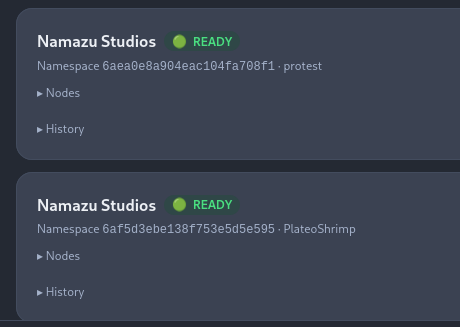

# namazu-apn-cloudformation

CloudFormation templates for granting the **Namazu co-selling agent**
access to your AWS account's Partner Central co-selling opportunities.

The Namazu co-selling agent is an AI assistant that works co-sell deals
in [AWS Partner Central](https://aws.amazon.com/partners/) on your
behalf: updating opportunities, responding to AWS referrals, submitting
deals for AWS co-sell review, keeping deal summaries current, and turning
them into client-ready documents. To do that it needs an IAM role in the
AWS account that is linked to your Partner Central — which is what these
templates create.

## How access works (and why it's safe)

The agent never holds static AWS credentials of any kind. Every request
it makes is performed under an **assumed role in your account**, taken
via AWS STS from Namazu's own hosting account, and — this is the part
that matters — every session it opens carries an individual **source
identity**. Each role created by these templates:

- trusts **only** Namazu's hosting account (principally-scoped trust —
  no wildcards),
- accepts assumptions **only** when the presented
  `sts:SourceIdentity` exactly matches the role's `AuthorizedUser` tag —
  so every action the agent takes appears in your CloudTrail under a
  named person, and you can revoke one person's access by deleting or
  re-tagging their role at any time,
- grants **only** Partner Central opportunity-management actions
  (`partnercentral:*` on the opportunity/referral/solution surface —
  nothing else: no EC2, no S3, no IAM, no account access of any other
  kind), and
- optionally pins the **catalog** (AWS production vs. AWS's isolated
  Sandbox test catalog) and an **external ID**, if you want the extra
  hardening.

The end customer accounts on your opportunities are never accessed — an
opportunity record *mentions* a customer's AWS account ID; the agent has
no permissions that could reach it.

## Cross-account: letting the Namazu agent work in your account

The sections above describe the trust model inside one account. The same
templates also let the Namazu co-selling agent (running in Namazu's hosting
account, 308044622771) assume roles in YOUR account — cross-account, with
no credentials ever shared.

**Onboarding happens in this order — each step has an owner:**

1. **You create the namespaces for your users** *(prerequisite)*. In
   Namazu Cloud, create a workspace for each user who will operate the
   co-selling agent. From this point you know their workspace ids (the
   screenshot below shows where the ids and user names appear).

2. **Namazu Studios adds the co-selling agent** to those workspaces.
   This provisions, in Namazu's account, each workspace's dedicated
   runner role —
   `arn:aws:iam::308044622771:role/cosell-agent-<identifier>-<workspace>`
   — using the identifiers you agree with your Namazu contact (your
   org-internal notation, e.g. `jsmith`; share the list in this step).

   > **Ordering note:** this step must come before step 3. IAM rejects
   > trust principals that do not exist, so adding a user whose runner
   > is not provisioned yet fails that user's update (the script
   > deploys each user separately and names the culprit, so a mismatch
   > never sinks the rest — but the runner must exist for the user to
   > be added at all).

3. **You enable the principals in your account.** Run
   `./manage-access.sh`:
   - **option 1** — the one-shot create: the well-known
     `Namazu-CoSell-Opportunity-Manager` role exists immediately, its
     trust an explicit deny (nobody may assume); a random external ID
     is generated (or supply `--external-id` up front).
   - **option 2** — add each user, two questions at a time: the
     **identifier** (the label in the runner role name Namazu Studios
     provisioned for that workspace — it is also the
     `sts:SourceIdentity` their sessions present, the id both sides
     attribute their actions to; for an existing deployment use the
     provisioned identifier, your Namazu contact confirms it) and the
     **workspace id** (exactly 24 hex characters). The script
     constructs the principal from the pair — you never paste an ARN —
     and composes one Allow statement per user into the role's trust.
   - **option 4** removes a user (their statement drops instantly);
     **options 5-8** flip the capability gates.

4. **You send the ticket report** the script prints after adding: the
   exact configuration Namazu needs — the external ID, the role ARN,
   and one `agent_apn` entry per user (workspace, identifier, source
   identity). Namazu wires the deployment to the role; from then on
   the agents can assume — and every action lands in your CloudTrail
   attributed to that user.

### Where to find the workspace id and the user name

Both values the add-user prompt asks for come from the same place —
your workspace's page in Namazu Cloud:



- **workspace id** — the 24-hex identifier shown for your workspace
  (e.g. `0a1b2c3d4e5f6a7b8c9d0e1f`). It is exactly what the add-user
  prompt expects: 24 characters, letters `a-f` and digits only.
- **user name** — the name Namazu Cloud shows for the user. It is the
  basis for the **identifier** you enter — but note the rule: the
  identifier must match the runner role Namazu Studios provisions for
  that workspace (`cosell-agent-<identifier>-<workspace>`). If the
  workspace already has a deployment, use the identifier already
  provisioned (your Namazu contact confirms it); for a new workspace,
  pick your org-internal notation — first initial + last name, e.g.
  `jsmith` — and share it with Namazu via the ticket report; they
  provision it verbatim. It is also the `sts:SourceIdentity` their
  sessions present, so it is how actions are attributed in CloudTrail.
  IAM rejects unknown principals: a mismatched identifier fails the
  update (the script deploys each user separately so one bad entry
  cannot sink the rest).

From then on, every action the agent takes in your account is that
assumed role in your CloudTrail, attributed to the named person, scoped
to the catalogs and actions your stack granted — and revocable by
removing the principal or deleting the stack (the role goes with it —
no retain). Nothing in your account is reachable except through that
one assumed role.

## Templates

### `templates/opportunity-manager-role.yaml` — default model

One shared `Namazu-CoSell-Opportunity-Manager` role, attributed to one named user
via the `AuthorizedUser` tag + source-identity match. Use this when one
person (e.g. your account manager) is the co-selling contact.

| Parameter | Required | What it does |
|---|---|---|
| `AuthorizedUser` | yes | The person this role is attributed to — becomes the source identity and the role's tag |
| `RoleName` | no | The role's name (default `Namazu-CoSell-Opportunity-Manager`). The prefix is fixed — it keeps the access identifiable as ours and the agent's side gates assumes to that namespace — but you may append a hyphenated suffix (e.g. `…-Manager-Prod`) if the default collides or your conventions call for one |
| `NamazuAccountId` | no | The Namazu hosting account to trust (default: Namazu Studios' production account — your contact will confirm) |
| `ExternalId` | no | Adds an `sts:ExternalId` condition if you want extra confused-deputy protection |
| `EnforceSessionName` | no | Pins the assume-role session name to `<user>-session` |
| `ResourceScope` | no | Narrows the permission policy's `Resource` (default `*`) |
| `CatalogPin` | no | Pins the role to one Partner Central catalog (`Sandbox` for trials, `AWS` for production) |


The `examples/` directory carries the plain policy JSON the template
embeds (the trust policy and the permission policy) if you want to
review the exact IAM documents or recreate them by hand.

## Quick start: the interactive manager

`manage-access.sh` manages the model end to end: **one stack, one
well-known role, access = the user list.** Option 1 is a ONE-SHOT
create: it asks nothing but the confirm (the external ID is generated,
or supply it with `--external-id`; the catalog defaults to Sandbox) and
deploys the role with its trust authorizing **nobody** — an explicit
deny for every principal; there is no account-root trust anywhere.
Options 2 and 4 add and remove users — two questions per user, one at
a time: the identifier (their org-internal notation, e.g. `jsmith` —
baked into the runner role name to be provisioned by Namazu Studios
AND the `sts:SourceIdentity` they present) and their workspace id. Each
user becomes one Allow statement in the trust: the runner role
Namazu Studios provisions for that workspace (constructed — you never
paste an ARN), presenting their identifier. Options 5-8 flip the
capability gates,
option 9 prints the ticket report, and option 0 deletes the stack —
**the role goes with it** (no retain: all access stops immediately).
The menu's help option (`h`) walks through every task step by step
with a field reference:

```bash
./manage-access.sh                      # menu: create / add users / list / remove / gates / report / delete
./manage-access.sh --region us-east-1   # or --stack-name to manage another stack
```

Requirements: bash and the AWS CLI, authenticated as a principal allowed
to create IAM roles in the account linked to your Partner Central
account. Nothing else — no `jq`. The script re-passes every existing
stack parameter on each update, so settings chosen at creation (the
external ID, the catalog pin, the session-name pin) survive every add,
remove, and gate flip.

The **ticket report** (printed after create and after every add, and
on demand via option 9 / `./manage-access.sh ticket`) is the exact
configuration Namazu needs: the external ID, the role ARN, the users
(workspace, identifier, source identity — or the nobody-authorized
state), and one contract entry per user in the exact shape the Namazu
deployment takes
(`consume_role_arn`, `user_name`, `source_identity`, `external_id`,
`catalog`), and the capability gates in force. After a gate flip, the
report shows the live gates.

The script deploys `templates/opportunity-manager-role.yaml` — the
only template: one role, one principal list.

## Using a template

From your AWS account **linked to Partner Central** (the account
alliance-lead/cloud-administrator uses for Partner Central — see AWS's
[account linking](https://docs.aws.amazon.com/partner-central/latest/getting-started/account-linking.html)
docs):

```bash
aws cloudformation deploy \
  --stack-name namazu-coselling-access \
  --template-file templates/opportunity-manager-role.yaml \
  --parameter-overrides AuthorizedUser=peter \
  --capabilities CAPABILITY_NAMED_IAM
```

(Or upload the template in the CloudFormation console. `CAPABILITY_NAMED_IAM`
is required because the stack creates a named IAM role.)

When the stack completes, the stack's **Outputs** show the role ARN.
Give that to your Namazu contact, along with the `ExternalId` value if
you set one — they wire it into the agent deployment on their side. That
configuration lives with Namazu; nothing further runs in your account.

## Prerequisites

- The AWS account you deploy from must be the one linked to your
  Partner Central account (opportunity permissions only function there).
- An IAM principal allowed to create roles and attach inline policies.

## Support

Questions or something not working? Contact your Namazu Studios
representative.

## License

MIT — see [LICENSE](LICENSE).

## License & provenance

**AGPL-3.0** — see [LICENSE](LICENSE).

Copyright 2026 Namazu Studios LLC.

Part of the [Namazu Cloud Addon system](https://github.com/NamazuStudios/namazu-cloud-addon).

This repository is made public for **transparency and visibility**: the
co-sell role shape here is the tenant-account half of the Namazu co-selling
agent story on Namazu Cloud, paired with the
[namazu-cloud-addon-agent-apn](https://github.com/NamazuStudios/namazu-cloud-addon-agent-apn)
official addon. It is written for Namazu Studios and Namazu Cloud use;
derivative works are expected to come back upstream to `NamazuStudios`,
no exceptions.

## AGPL waiver for delivered work

Namazu Studios, as the copyright holder, **waives all AGPL obligations for
software installed through a purchase or other business arrangement
between Namazu Studios and the client.** The AGPL terms above govern the
code as published in this repository; work delivered to you under
contract — including anything installed on your behalf by Namazu Studios —
is delivered under that agreement, not under the license's reciprocity
terms.
